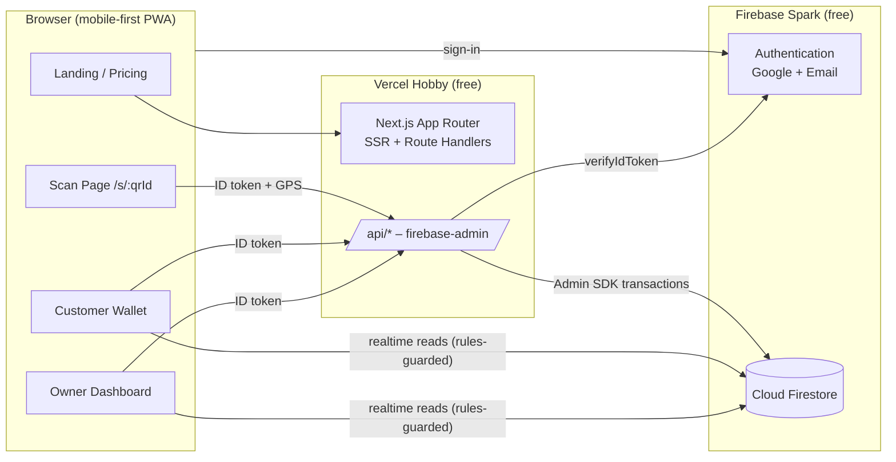
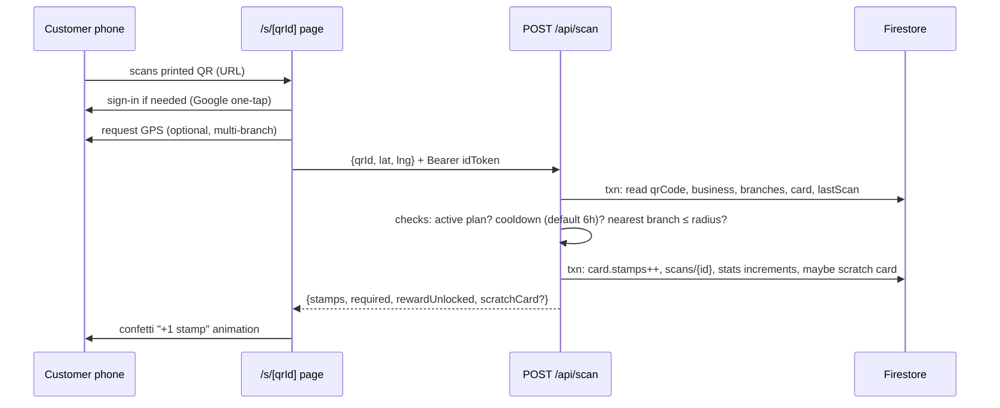

# Architecture

## 1. High-level diagram

**Principle:** *Reads* go client → Firestore directly (protected by rules, realtime).
*Writes that matter* (stamps, redemptions, scratch cards, stats) go through `/api/*`
which runs trusted logic with the Admin SDK. This replaces Cloud Functions on the free plan.

## 2. Roles
| Role | How assigned | Can |
|---|---|---|
| `customer` | default on first sign-in | scan, view own cards, redeem rewards |
| `owner` | chooses "I'm a business" at onboarding | manage own business, branches, rewards, menu, staff |
| `staff` | invited by owner (email) | confirm redemptions for that business |
| `admin` | manually set via `scripts/set-admin.ts` (custom claim) | everything |

Role lives in `users/{uid}.role` **and** as a custom claim (`role`) set by the API at onboarding,
so rules can check `request.auth.token.role` without extra reads.

## 3. Core flows

### 3.1 Owner onboarding
1. Sign in (Google / email) → `POST /api/onboarding/owner` `{businessName, category, reward}`
2. API creates `businesses/{bizId}`, first `branches/{branchId}`, default `rewardProgram`,
   a `qrCodes/{qrId}` doc (short random ID), sets claim `role=owner`, trial `trialEndsAt = now+3d`.
3. Client force-refreshes token (`getIdToken(true)`) → redirect `/dashboard`.

### 3.2 Customer scan (the heart of the product)

**Anti-abuse:** cooldown per customer per business, max scans/day, optional GPS radius
(Haversine, default 200 m), scan doc keyed `${uid}_${bizId}_${yyyymmddHH}` to make duplicate
taps idempotent.

### 3.3 Reward redemption
1. Card reaches `required` → `card.status = "rewardReady"`.
2. Customer taps **Redeem** → `POST /api/redeem` creates `redemptions/{id}` with a 6-digit
   code, status `pending`, expires in 10 min.
3. Staff/owner sees it live in dashboard → `POST /api/redeem/confirm` → card resets
   (`stamps=0`, `completedCount++`), stats updated.

### 3.4 Scratch cards
On scan, API rolls probability from `business.scratchConfig` → creates
`scratchCards/{id}` (`revealed=false`). Customer scratches in UI → `POST /api/scratch/reveal`.
Prize is decided server-side at creation; the client never knows it until reveal.

### 3.5 Digital menu ("AI menu")
MVP: owner enters categories/items manually. v2: owner pastes menu text or uploads a photo →
`POST /api/menu/parse` calls an LLM (Gemini free tier / Azure OpenAI) to return structured JSON
(validated by Zod) → owner reviews → saved. Public at `/m/[slug]`.

### 3.6 Billing (later)
Razorpay Checkout → webhook `POST /api/billing/webhook` (verify signature) → update
`business.plan`, `planExpiresAt`, `maxBranches`. Until then plans are set manually by admin.

## 4. Free-tier budget estimate
One scan ≈ 5 reads + 4 writes. 20K writes/day ⇒ ~4,000 scans/day ceiling — fine for MVP.
Dashboard uses `dailyStats` docs (1 read per day shown) instead of querying scans.

## 5. Environments
- **local**: Firebase project configured through `.env.local`; local development uses the configured
  Firebase Authentication and Firestore instances.
- **prod**: Firebase project + Vercel, or Firebase App Hosting (requires the Blaze plan). Separate
  Firebase project for staging if desired.
